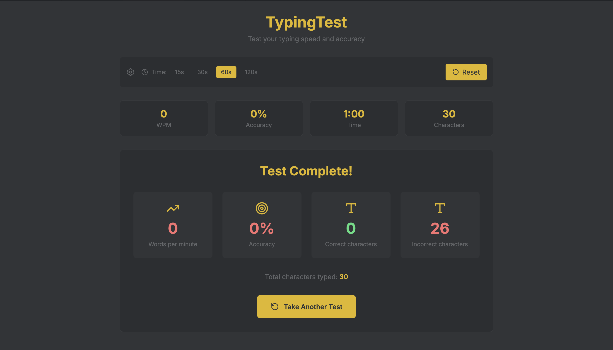
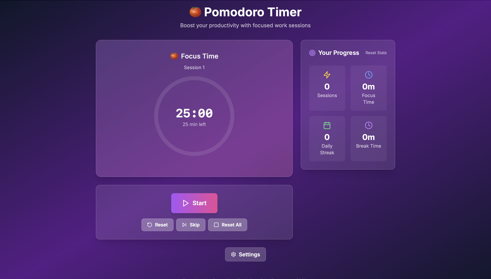
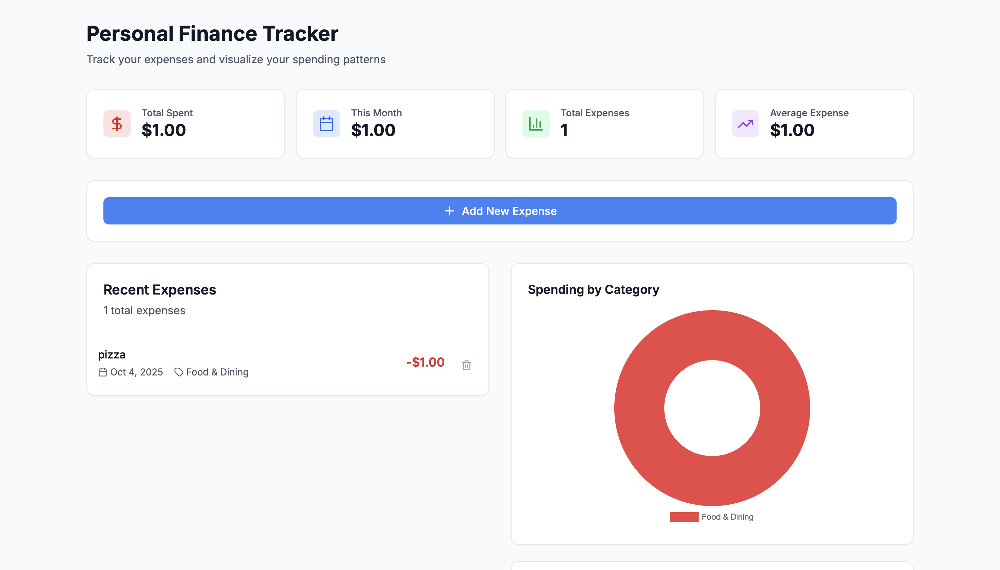
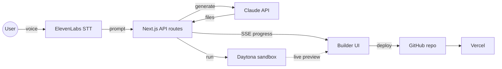

<div align="center">

# EchoMe

**Say what you want to build. Get a live, deployed web app.**

[](https://github.com/obro79/stormhacks/actions/workflows/ci.yml)
[](LICENSE)
[](https://nextjs.org/)
[](https://www.typescriptlang.org/)
[](https://www.anthropic.com/)

🏆 **1st place overall, StormHacks 2025**

[Demo video](https://www.youtube.com/watch?v=RmVdUAm20Ms) · [Devpost](https://devpost.com/software/echome-ixe6qy) · [Architecture](docs/ARCHITECTURE.md)

</div>

<!-- TODO(owen): record a short demo GIF (voice prompt -> live preview -> deploy) and save it as docs/images/demo.gif, then replace the video thumbnail below. -->
[](https://www.youtube.com/watch?v=RmVdUAm20Ms)

## What it does

- **Voice in.** Describe an app out loud; ElevenLabs speech-to-text turns it into a prompt.
- **Code out.** Claude generates a complete Next.js project, file by file.
- **Live preview.** The project boots in a Daytona sandbox and streams build progress to the browser over SSE.
- **Iterate.** Browse the generated code, chat with Claude about it, or download it as a ZIP.
- **One-click deploy.** EchoMe creates a GitHub repo and ships it to Vercel.

<table>
  <tr>
    <td align="center"><br/><sub>Typing test</sub></td>
    <td align="center"><br/><sub>Pomodoro timer</sub></td>
    <td align="center"><br/><sub>Finance tracker</sub></td>
  </tr>
</table>
<p align="center"><sub>Apps generated and deployed by EchoMe from a single spoken prompt.</sub></p>

## Architecture

The browser only captures audio and renders the builder. Everything that holds an API key runs in Next.js route handlers. A build is fire-and-forget: the server calls Claude, parses the files, boots them in a Daytona sandbox, and streams each step back over Server-Sent Events. Deploys go through the GitHub Git Data API and the Vercel API.



The full request flow, module map and design trade-offs are in **[docs/ARCHITECTURE.md](docs/ARCHITECTURE.md)**.

## Tech stack

| Layer | Tools |
|---|---|
| App | Next.js 16 (App Router), React 19, TypeScript, Tailwind CSS 4, shadcn/ui |
| AI | Claude Messages API (code generation and chat), ElevenLabs Scribe (speech-to-text) |
| Runtime | Daytona sandboxes for live previews |
| Auth | Supabase |
| Deploy | GitHub REST API, Vercel API |
| Quality | Vitest, ESLint, GitHub Actions |

## Run locally

**Prerequisites:** Node.js 22, plus accounts and API keys for Anthropic, ElevenLabs, Daytona and Supabase. GitHub and Vercel tokens are only needed for one-click deploy.

```bash
git clone https://github.com/obro79/stormhacks.git
cd stormhacks
npm install
cp .env.example .env.local   # fill in your keys
npm run dev                  # http://localhost:3000
```

| Variable | Used for |
|---|---|
| `CLAUDE_API_KEY` | Code generation and builder chat |
| `CLAUDE_MODEL` | Optional model override |
| `ELEVENLABS_API_KEY` | Speech-to-text |
| `DAYTONA_API_KEY`, `DAYTONA_API_URL`, `DAYTONA_TARGET` | Live preview sandboxes |
| `NEXT_PUBLIC_SUPABASE_URL`, `NEXT_PUBLIC_SUPABASE_ANON_KEY` | Sign-in |
| `GITHUB_TOKEN`, `GITHUB_USERNAME`, `VERCEL_TOKEN` | One-click deploy |
| `CLEANUP_TOKEN` | Optional. Enables the admin sandbox cleanup endpoint |

## Tests

```bash
npm test            # Vitest: parser, validation, naming, log classifier, API routes
npm run lint
npm run typecheck
npm run build
```

CI runs all four on every push and pull request.

## Team

Built at StormHacks 2025 by:

- **Owen Fisher** ([@obro79](https://github.com/obro79))
- **Lukas Moser**
- **Jericho Fillon** ([@kznCORP](https://github.com/kznCORP))
- **Brian Soh**

## License

[MIT](LICENSE)
