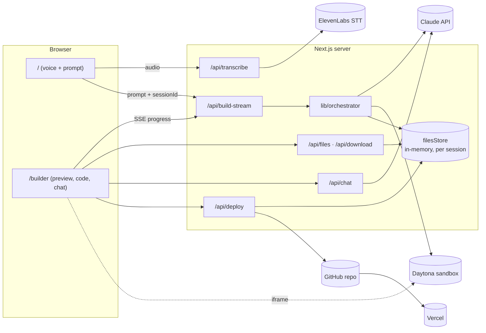

# Architecture

EchoMe is a single Next.js 16 (App Router) app. The browser handles voice capture and the builder UI; everything that touches an API key runs in Next.js route handlers on the server.

## System overview

## Request flow

1. **Voice to text.** The home page records audio with `MediaRecorder` and posts it to `/api/transcribe`, which proxies to ElevenLabs so the API key never reaches the browser.
2. **Kick off a build.** The client generates a `sessionId`, redirects to `/builder`, and POSTs `{ prompt, sessionId }` to `/api/build-stream`. The handler returns immediately and runs the build in the background.
3. **Generate code.** `lib/orchestrator.buildApp` calls Claude with a system prompt that asks for a strict `<files>` / `FILE:` format. `lib/parseFiles` turns the response into `FileChange[]`.
4. **Run a live preview.** `lib/daytona.createDaytonaSandbox` uploads the files (paths go through `sanitizeRelativePath`), runs `npm install` and `npm run dev`, then reads the dev-server log with `lib/serverLogs.classifyDevServerLogs` to decide whether the app came up. If anything fails, the sandbox is deleted.
5. **Stream progress.** The builder page opens an `EventSource` on `GET /api/build-stream`. Each step is one SSE frame; the stream ends with `COMPLETE:<previewUrl>` or `ERROR:<message>` (see `lib/progress`).
6. **Deploy.** `/api/deploy` takes the session's files and calls `lib/deployHelpers.deployToGitHubAndVercel`: it creates a public repo through the GitHub Git Data API (blobs, tree, commit, ref), creates a Vercel project linked to it, and polls until the deployment is `READY`.

## Module map

| Module | Responsibility | Side effects |
|---|---|---|
| `lib/parseFiles.ts` | Parse Claude's `<files>` output | none (pure, tested) |
| `lib/validation.ts` | Session IDs, GitHub usernames, repo names, path sanitizing | none (pure, tested) |
| `lib/naming.ts` | Project and repo names from the prompt | none (pure, tested) |
| `lib/serverLogs.ts` | Classify `next dev` logs as ready, error or unknown | none (pure, tested) |
| `lib/progress.ts` | SSE framing and terminal-message protocol | none (pure, tested) |
| `lib/api.ts` | Thin Claude Messages API client | network |
| `lib/orchestrator.ts` | Prompt, then parse, then sandbox | network |
| `lib/daytona.ts` | Sandbox lifecycle | network |
| `lib/githubService.ts` / `lib/vercelService.ts` | Repo creation and Vercel deploys | network |
| `lib/filesStore.ts` | Generated files per session | process memory |

The pure modules hold the logic that is easy to get wrong, which is why the test suite targets them. The network modules are thin wrappers around them, and the route handlers are covered by tests in `src/app/api/__tests__` with the network layer mocked.

## Design decisions and known limits

- **In-memory session state.** `filesStore` and the build-progress map live in server memory. That kept the hackathon build simple, but it assumes a single long-lived server process; on serverless or multi-instance hosting, sessions would need Redis or Supabase.
- **Fire-and-forget builds.** `POST /api/build-stream` returns before the build finishes so the UI can navigate right away. Progress is polled from memory every 500 ms and pushed over SSE.
- **Strict output format over tool use.** A plain-text `FILE:` protocol made the parser easy to reason about and test. Moving to Claude tool use with structured output is the natural next step.
- **Admin-only cleanup.** `POST /api/cleanup` deletes every sandbox on the account, so it is off unless `CLEANUP_TOKEN` is set and sent as a bearer token.
